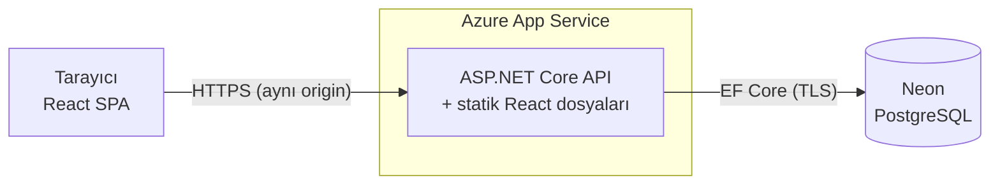
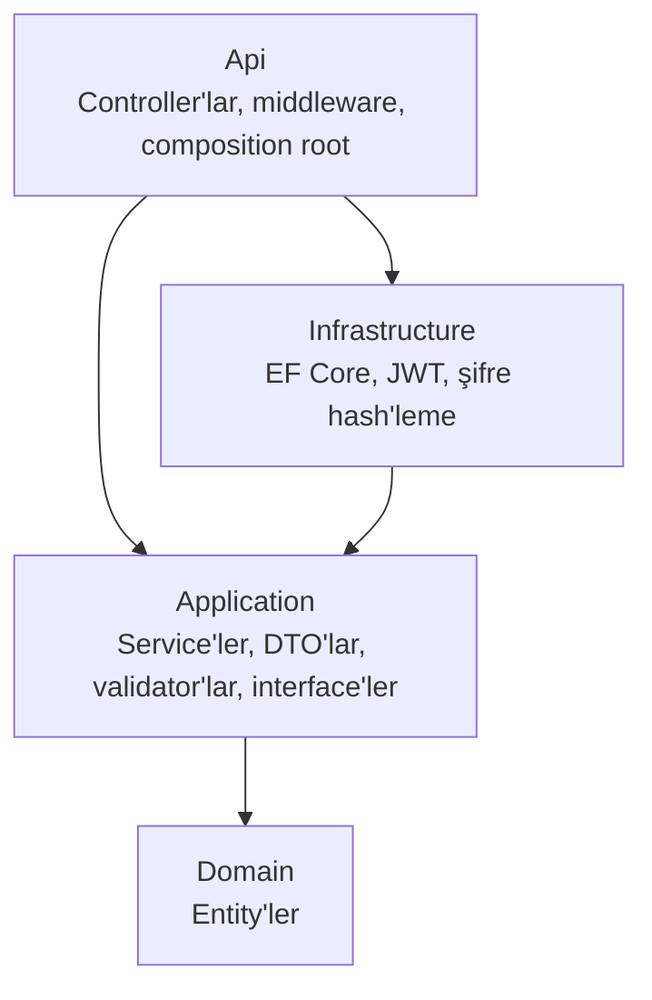

# Görev Yöneticisi — Full Stack (.NET 10 + React)

[](https://github.com/ismethakanaydogmus/task-management-application/actions/workflows/ci.yml)

Kullanıcıların kayıt olup kendi görevlerini oluşturduğu, filtreleyip aradığı ve takip ettiği bir görev yönetim uygulaması.
Amaç basit bir "to-do" listesinin ötesine geçip **gerçek bir üretim uygulamasında beklenen** mimari, güvenlik,
test ve dağıtım pratiklerini uçtan uca uygulamak.

**🔗 Canlı demo:** https://task-management-ismet.azurewebsites.net

> Ücretsiz Azure planında barındırıldığı için uygulama bir süre kullanılmayınca uyku moduna geçer; ilk açılış 10–20 saniye sürebilir.

---

## Özellikler

- **Hesap sistemi:** Kayıt, giriş, oturumun sayfa yenilenince korunması, çıkış
- **Görevler:** Oluşturma, düzenleme, tamamlama, silme; öncelik ve son tarih
- **Liste:** Durum ve öncelik filtresi, başlık/açıklamada arama, sıralama, sayfalama
- **Gizlilik:** Her kullanıcı yalnızca kendi görevlerini görebilir ve değiştirebilir
- **Kullanıcı deneyimi:** Yükleniyor / hata / boş durumları, alan bazlı doğrulama mesajları, açık/koyu tema, mobil uyum

## Teknolojiler

| Katman | Teknoloji |
|---|---|
| Backend | ASP.NET Core 10 Web API, C# 14 |
| Mimari | Clean Architecture (Domain / Application / Infrastructure / Api) |
| Veri | PostgreSQL, Entity Framework Core 10, migration'lar |
| Doğrulama ve hatalar | FluentValidation, RFC 9457 ProblemDetails, global exception handler |
| Kimlik doğrulama | JWT access token + rotation'lı refresh token (httpOnly cookie), PBKDF2 şifre hash'leme |
| Frontend | React 19, TypeScript, Vite, TanStack Query |
| Test | xUnit, Testcontainers (gerçek PostgreSQL), Vitest, Testing Library |
| Altyapı | Docker (multi-stage), nginx, GitHub Actions CI |
| Canlı ortam | Azure App Service (Free F1, Linux), Neon (serverless PostgreSQL) |

## Mimari



Backend katmanları ve bağımlılık yönü (bağımlılıklar her zaman içe doğru):



İş mantığı (Application) veritabanını veya HTTP'yi bilmez; ihtiyaç duyduğu yetenekleri interface olarak tanımlar,
Infrastructure bunları gerçekleştirir (Dependency Inversion). Kural derleyici tarafından zorlanır: Application projesinin
EF Core'a referansı yoktur.

## Öne çıkan mühendislik kararları

**Güvenlik**
- **IDOR koruması:** Sahiplik kontrolü ayrı bir `if` değil, sorgunun kendisi (`WHERE id = @id AND user_id = @me`).
  Başkasının görevine erişim, hiç var olmayan bir görevle aynı **404** cevabını alır; kaynağın varlığı bile sızmaz.
- **Token saklama:** Access token yalnızca JavaScript belleğinde (15 dk), refresh token `HttpOnly; Secure; SameSite=Strict`
  cookie'de. XSS ile token çalınamaz; sayfa yenilenince oturum sessizce yenilenir.
- **Refresh token rotation + reuse detection:** Her refresh token tek kullanımlık. Daha önce kullanılmış bir token tekrar
  gelirse (çalınma göstergesi) kullanıcının tüm oturumları kapatılır. Veritabanında token'ların yalnızca hash'i tutulur.
- **"Varsayılan olarak güvenli":** Fallback authorization policy ile her endpoint giriş ister; herkese açık olanlar bilinçli olarak açılır.
- Kullanıcı numaralandırma ve zamanlama saldırısına karşı aynı hata mesajı ve sabit süreli doğrulama, giriş uç noktalarında
  rate limiting, LIKE joker karakter kaçışı, sıralama alanlarında whitelist, Content-Security-Policy ve diğer güvenlik başlıkları.

**Veri ve API**
- Tüm hatalar tek tip **ProblemDetails** JSON'u; alan bazlı hatalar frontend'de ilgili input'un altında gösterilir.
- Filtreleme, arama, sıralama ve sayfalama veritabanında; sorgu kalıbına göre composite index'ler.
- Deterministik sıralama (eşit değerlerde `id` ile ikincil sıralama) → sayfalar arasında tekrar eden veya kaybolan kayıt yok.
- Geçici bağlantı hatalarında otomatik yeniden deneme (EF Core execution strategy); `CancellationToken` istemciden veritabanına kadar taşınır.

**Frontend**
- Sunucu verisi (TanStack Query) ile istemci durumu (`useState`) ayrımı; önbellek anahtarı hiyerarşisi ve invalidation.
- Eşzamanlı 401'lerde **tek** refresh isteği (single-flight) — refresh token rotation ile birlikte kullanıldığında şart.
- Erişilebilir formlar (`label`, `aria-invalid`, `role="alert"`), arama için debounce, sayfa geçişinde önceki verinin korunması.

## Testler

| Grup | Sayı | Kapsam |
|---|---|---|
| Backend unit | 28 | İş kuralları, doğrulama, sahiplik, token rotation ve reuse detection (`FakeTimeProvider` ile zaman kontrolü) |
| Backend integration | 25 | Gerçek HTTP + gerçek PostgreSQL (Testcontainers): IDOR, sıralama/arama/sayfalama, cookie bayrakları, eksik migration kontrolü, health check |
| Frontend | 21 | Form davranışı, backend hatalarının gösterimi, saat dilimi dönüşümü, single-flight refresh |

Testlerin gerçekten hata yakaladığı, koda bilerek hata sokularak (mutation) doğrulandı.
Tüm testler her push'ta **GitHub Actions** üzerinde çalışır.

## Projeyi çalıştırma

### Seçenek 1 — Sadece Docker ile (en hızlı)

```bash
cp .env.example .env    # POSTGRES_PASSWORD ve JWT_SIGNING_KEY değerlerini değiştir
docker compose -f docker-compose.prod.yml up -d --build
```
→ http://localhost:8080

Başlatma sırası: `db` → `migrator` (migration'ları uygular ve çıkar) → `api` → `web` (nginx).
Dışarıya yalnızca web portu açılır; API ve veritabanı iç ağdadır.

### Seçenek 2 — Geliştirme ortamı

Gerekenler: .NET 10 SDK, Node.js 24, Docker

```bash
cp .env.example .env
docker compose up -d                        # PostgreSQL (localhost:5433)

cd backend
dotnet tool restore
dotnet user-secrets set "ConnectionStrings:Default" "Host=localhost;Port=5433;Database=taskmanager;Username=taskmanager;Password=<.env'deki şifre>" --project src/TaskManager.Api
dotnet user-secrets set "Jwt:SigningKey" "$(openssl rand -base64 64)" --project src/TaskManager.Api
dotnet ef database update --project src/TaskManager.Infrastructure --startup-project src/TaskManager.Api
dotnet run --project src/TaskManager.Api    # http://localhost:5263

cd ../frontend
npm install
npm run dev                                 # http://localhost:5173
```

### Testler

```bash
cd backend && dotnet test     # integration testler için Docker açık olmalı
cd frontend && npm test
```

## Proje yapısı

```
├── backend/
│   ├── src/
│   │   ├── TaskManager.Domain/            # Entity'ler
│   │   ├── TaskManager.Application/       # Service'ler, DTO'lar, validator'lar, interface'ler
│   │   ├── TaskManager.Infrastructure/    # EF Core, migration'lar, JWT, şifre hash'leme
│   │   └── TaskManager.Api/               # Controller'lar, middleware, hata yönetimi
│   ├── tests/
│   │   ├── TaskManager.UnitTests/
│   │   └── TaskManager.IntegrationTests/
│   └── Dockerfile                         # api ve migration bundle image'ları
├── frontend/
│   ├── src/
│   │   ├── api/                           # fetch sarmalayıcı, token yenileme
│   │   ├── auth/                          # oturum durumu (Context)
│   │   ├── components/
│   │   └── hooks/                         # TanStack Query hook'ları
│   ├── Dockerfile                         # nginx ile statik sunum
│   └── nginx.conf                         # reverse proxy + güvenlik başlıkları
├── Dockerfile                             # tek container (Azure): API + React
├── docker-compose.yml                     # geliştirme veritabanı
├── docker-compose.prod.yml                # tam sistem
└── .github/workflows/ci.yml
```

## Canlı ortam (dağıtım)

- **Tek uygulama, tek origin:** React build çıktısı ASP.NET Core uygulamasının `wwwroot` klasörüne konur; API hem
  arayüzü hem `/api` uç noktalarını sunar. Böylece CORS'a gerek kalmaz ve `SameSite=Strict` refresh cookie'si çalışır.
- **Barındırma:** Azure App Service, **Free (F1)** plan, Linux, .NET 10. Ücretli bir kademesi olmadığı için kota aşılsa bile
  ücret oluşmaz (uygulama o gün için durdurulur). Bedeli: bir süre kullanılmayınca uyku moduna geçer, ilk istek birkaç saniye sürer.
- **Veritabanı:** Neon serverless PostgreSQL (ücretsiz plan); migration'lar EF Core migration bundle ile uygulanır.
- **Gizli bilgiler:** Bağlantı dizesi ve JWT imza anahtarı App Service uygulama ayarlarında (ortam değişkeni) tutulur;
  repoda yer almaz.
- Kök `Dockerfile` aynı tek-uygulama paketini container olarak üretir (Container Apps, Kubernetes vb. için).

---

Geliştiren: **İsmet Hakan Aydoğmuş** · [GitHub](https://github.com/ismethakanaydogmus)
